<p align="center">
  
</p>

<h1 align="center">J.A.R.V.I.S. Voice Assistant</h1>

<p align="center">
  A voice assistant for Windows with a movie-style animated HUD.<br>
  Say "Jarvis", give a command, and watch the interface respond.
</p>

---

## Features

- **Wake word:** say "Jarvis", then your command. After that, Jarvis stays awake until 15 seconds pass with no speech.
- **Animated HUD:** a pygame interface with rotating rings, a scanner, and an audio visualizer. It shows the current state (standby, listening, processing, responding) and the text of your conversation.
- **Voice replies:** answers are spoken aloud with Google Text-to-Speech.
- **Local AI chat:** anything that isn't a built-in command goes to an [Ollama](https://ollama.com) model (`llama3.2`), which keeps the last 10 messages as context.
- **Computer control:** volume, media keys, Notepad typing, and opening apps and websites.

## Voice commands

| Say | What happens |
|---|---|
| "Jarvis" | Wakes Jarvis up |
| "volume up" / "louder" | Raises the volume |
| "volume down" / "quieter" | Lowers the volume |
| "play music" / "play spotify" | Opens Spotify and presses play |
| "play song *name*" | Searches Spotify for the song and presses space |
| "next song" / "skip" | Skips to the next track |
| "what time is it" | Tells you the time |
| "what is the date" / "today" | Tells you the date |
| "weather in *city*" | Reads the weather from wttr.in |
| "search *topic*" / "google *topic*" | Reads the top 3 DuckDuckGo result titles |
| "write *text* in Notepad" | Opens Notepad and types the text |
| "open spotify / notepad / youtube / gmail / google" | Opens that app or website |
| "exit", "goodbye", "shut down" | Closes the assistant |
| Anything else | Sent to the AI model for an answer |

## HUD states

| State | What you see |
|---|---|
| Standby | Dim cyan rings, waiting for you |
| Listening | Gold scanner sweeps and the microphone is recording |
| Processing | The AI model is working on an answer |
| Responding | The core pulses and the bars move while Jarvis speaks |

## Requirements

- **Windows 10 or 11.** The code uses `ctypes.windll` and `os.startfile`, which only exist on Windows.
- **Python 3.8 or newer**
- **A working microphone**
- **An internet connection.** Speech recognition, text-to-speech, search, and weather all need it.
- **Ollama** installed and running, with the `llama3.2` model

## Installation

1. Clone the repo:
   ```
   git clone https://github.com/zeinamagdy-gif/YOUR_REPO.git
   cd YOUR_REPO
   ```

2. Install the Python packages:
   ```
   pip install requests SpeechRecognition pygame pyautogui gTTS duckduckgo_search pyaudio
   ```
   If `pyaudio` fails to install, try `pip install pipwin` followed by `pipwin install pyaudio`.

3. Install [Ollama](https://ollama.com), then download the model:
   ```
   ollama pull llama3.2
   ```

## Usage

1. Make sure Ollama is running. It listens on `http://localhost:11434`.
2. Start Jarvis:
   ```
   python jarvis.py
   ```
   Replace `jarvis.py` with the name of your script.
3. Wait for the greeting, then say "Jarvis, what's the weather in Cairo?" or any other command.

Close the window to quit.

## Customization

- **Greeting:** change `"Welcome Back Zeina"` in `listen_loop`.
- **Voice accent:** change the `tld` value in `gTTS(...)` (for example `'co.uk'` or `'com'`).
- **AI model:** change `"llama3.2"` in `ask_ai` to any model you have pulled in Ollama.
- **Wake word:** replace `"jarvis"` in `listen_loop`.
- **Idle timeout:** change `15` in `listen_loop`.
- **HUD colors:** edit the color values at the top of `JarvisHUD.__init__`.

## Troubleshooting

- **"I cannot connect to my brain":** Ollama isn't running. Start it, and check that `ollama pull llama3.2` finished.
- **Jarvis never hears me:** check that your default microphone is set correctly in Windows sound settings, and that `pyaudio` is installed.
- **Speech recognition errors:** the Google recognizer needs internet access.
- **Spotify or Notepad commands do nothing:** these use keyboard automation, so keep the right window in focus and don't move the mouse while they run.

## Built with

[pygame](https://www.pygame.org) · [SpeechRecognition](https://pypi.org/project/SpeechRecognition/) · [gTTS](https://pypi.org/project/gTTS/) · [PyAutoGUI](https://pyautogui.readthedocs.io) · [Ollama](https://ollama.com) · [DuckDuckGo Search](https://pypi.org/project/duckduckgo-search/) · [wttr.in](https://wttr.in)
